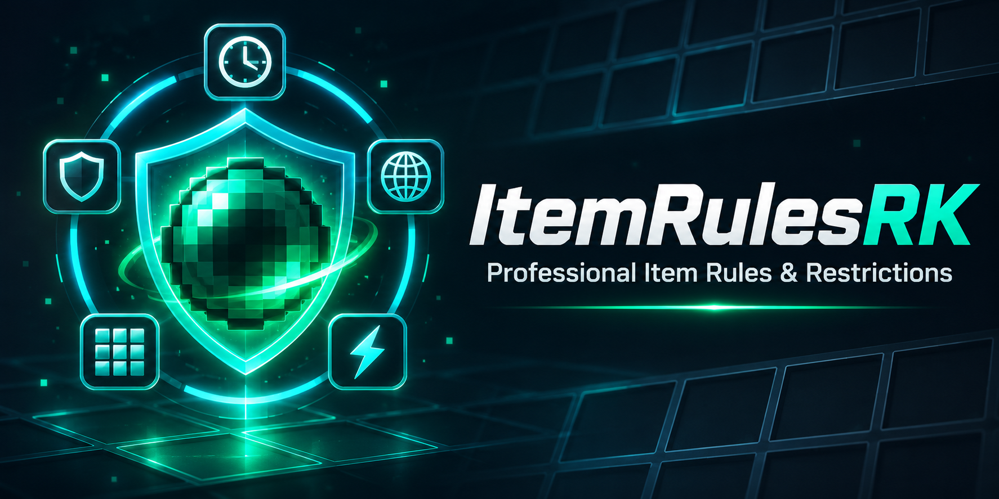

# ItemRulesRK 1.0.0

ItemRulesRK is an English-first, event-driven item restriction engine for Spigot, Paper and Purpur servers. It applies rules only when relevant Bukkit events occur; it does not scan every player or inventory on a repeating task.

Complete administrator documentation is available in the [ItemRulesRK wiki](wiki/Home.md), including installation, GUI creation, YAML examples, permissions, integrations and troubleshooting.

## Requirements and compatibility

- Minecraft 1.16.5 or newer Bukkit-compatible servers.
- Java 8 for Minecraft 1.16.5; use the Java version required by newer Minecraft releases.
- One JAR for the supported range.
- Optional: WorldGuard, PlaceholderAPI, Vault plus an economy provider, ItemsAdder, Oraxen, Nexo or MMOItems.

The JAR is compiled against the Spigot 1.16.5 API. A successful build or startup smoke test is not a claim that every optional plugin version has been live-tested.

## Installation

1. Put `ItemRulesRK-1.0.0.jar` in `plugins/`.
2. Start the server. Every public example is disabled.
3. Run `/itemrules gui` to create rules visually, or edit `rules.yml` manually.
4. Use `/itemrules reload` after manual YAML changes. Never use Bukkit `/reload`.

## Rule engine

Rules can match material, display name, lore, CustomModelData, enchantments, custom-item provider IDs, hand, worlds, WorldGuard regions, gamemodes, permissions, health, Y level, sneaking, time, experience, Vault balance, combat state and PlaceholderAPI comparisons.

Triggers: `RIGHT_CLICK`, `LEFT_CLICK`, `CONSUME`, `PLACE`, `DROP`, `PICKUP`, `SHOOT`, `THROW`, `BREAK`, `CRAFT`, `ENCHANT`, `SWAP_HAND` and `TOTEM_USE`.

Actions: cancel, chat message, actionbar, title/subtitle, sound, particle, potion effect, console/player commands, remove items, damage, cooldown and inventory limit. PlaceholderAPI expansion in commands is opt-in and permission-protected.

Inventory limits protect pickups, partial pickup, containers, cursor, shift-click, number keys, hotbar swaps, creative inventory, crafting results and off-hand movement without a repeating inventory scan.

## Visual editor

`/itemrules gui` provides:

- creation from scratch, templates, duplication and safe import;
- persistent private drafts that survive closing the inventory, disconnects and restarts;
- undo/redo, final validation and atomic application;
- edit locks and revision-conflict detection for multiple administrators;
- rule details, search, filters, history, trash recovery, groups, diagnostics, statistics and temporary exceptions;
- a filtered dry run that never executes actions, events, cooldowns or statistics;
- protected clicks, drag, shift-click, number keys and cursor paths;
- English and Spanish locale files with per-key fallback to bundled English.

Manual rules remain read-only in the GUI. Duplicate one to edit it safely. GUI-managed rules live in `gui-rules.yml`; drafts, history, trash, audit data and locks are stored separately.

## Commands

- `/itemrules reload`
- `/itemrules list [page]`
- `/itemrules info <rule>`
- `/itemrules test [trigger]`
- `/itemrules doctor`
- `/itemrules stats`
- `/itemrules group <group> <enable|disable>`
- `/itemrules gui [rules|rule|create|drafts|diagnostics]`
- `/itemrules export <rule>`
- `/itemrules import <file>` (player-only; creates disabled private drafts)
- `/itemrules exception <player> <rule|*> <duration|permanent|clear>`

Every command and GUI mutation is permission-checked on the server. See `plugin.yml` for granular permissions.

## Public API and events

Other plugins can obtain `ItemRulesAPI` from the ItemRulesRK plugin instance and listen for rule
match, execution, cooldown and administrative change events. API consumers must resolve rules by ID
again after reloads or administrative changes: applying, renaming, archiving or deleting a rule
publishes a new immutable snapshot, and an old `Rule` object must not be cached indefinitely.

Dry runs never fire these public events. Administrative change events are emitted only after the
corresponding persisted change and configuration publication succeed.

## Files and safe updates

- `config.yml`: engine, GUI, limits, retention, hooks, metrics and update settings.
- `rules.yml`: commented manual rules; never rewritten by the GUI.
- `groups.yml`: commented manual groups; never rewritten by the GUI.
- `gui.yml`: visual settings only.
- `gui-rules.yml` and `gui-groups.yml`: GUI-managed definitions.
- `templates.yml`: reusable rule templates.
- `locale/messages_<language>.yml`: general messages.
- `locale/messages_gui_<language>.yml`: GUI text.

Existing files are not replaced. Older schemas receive `config.update.1.0.0.yml` and `rules.update.1.0.0.yml`. Legacy imported rules and locale overrides are migrated once with originals preserved.

## Metrics and update checks

bStats and the HTTPS update checker are disabled by default. bStats starts only with a real project ID. The update checker reads version metadata asynchronously and never downloads or installs files.

## Build

Run `mvn -B clean verify` with JDK 17 or newer. The resulting bytecode targets Java 8.
